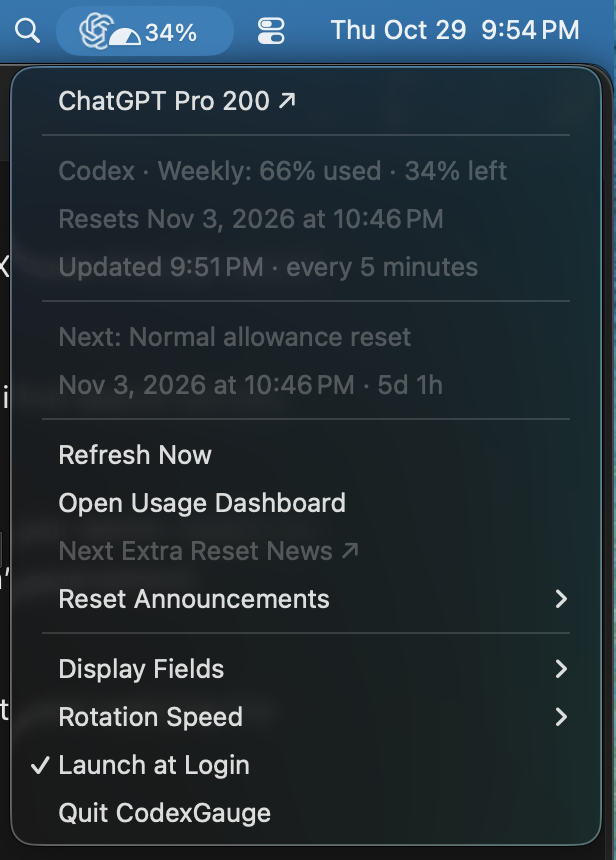

# CodexGauge

An open-source macOS menu-bar app that **monitors official announcements for extra Codex resets and shows a live countdown** alongside your ChatGPT plan’s Codex usage. The countdown automatically uses the earlier of your normal reset and a confirmed extra reset.

<p align="center">
  
</p>


- **Extra-reset monitoring:** checks configured official news sources hourly by default. When a verified future extra reset is found, the countdown includes it automatically.
- **Next Extra Reset News:** opens the announcement for the next confirmed extra reset, even when your normal reset comes first. When no upcoming extra reset exists, it links to the last timed extra reset announcement retained by the app, if available.
- Compact ChatGPT logo with a filled semicircular usage gauge.
- Optional percentage remaining, reset countdown, and Codex credit balance, rotating every four seconds by default. Rotation speed is configurable; the icon stays in place.
- Countdown uses the earlier normal reset or verified future extra automatic reset.
- Independent official-announcement checks: 5 minutes, 15 minutes, 1 hour (default), 2 hours, 6 hours, or daily.
- Plan heading resolved from the live account plan code and the installed ChatGPT Usage & billing page's label definitions.
- Plan heading opens https://chatgpt.com/settings/billing?mweb_fallback=1; usage opens https://chatgpt.com/settings/usage.
- The menu shows the last reset the app detected while monitoring usage. A decrease in weekly usage to below 10% is treated as a reset; its recorded time is when the decrease is detected, which can be up to one refresh interval later. Corrections to reported usage may also trigger it.
- Optional launch at login.

## Install

Download the [latest release](https://github.com/halfdome/CodexGauge-public/releases/latest) and choose either option:

- **Installer:** Open `CodexGauge-2.3.0-universal.pkg` and follow the prompts to install CodexGauge in Applications. You may be asked for an administrator password.
- **ZIP:** Unzip `CodexGauge-2.3.0-universal.zip` and drag CodexGauge to Applications.

Quit any older copy first. Open CodexGauge from Applications; it appears in the menu bar. Sign in to the official ChatGPT or Codex app if needed.

Both downloads support Apple Silicon and Intel Macs running macOS 13 or later. The installer is unsigned and the app is ad-hoc signed; neither is notarized by Apple. macOS may block them or require approval in Privacy & Security. Download releases only from this repository.

CodexGauge reads usage through an installed official Codex helper (from the ChatGPT or Codex app, or Codex CLI). For the ChatGPT logo and detailed plan labels, install the official ChatGPT app in `/Applications`.

## Build and test from source

Requires macOS 13+, Python 3, and Xcode Command Line Tools.

```sh
python3 build.py --test
python3 build.py                  # Build for this Mac
python3 build.py --universal      # Build for Apple Silicon and Intel
```

The built app is `build/CodexGauge.app`. Its bundle identifier remains `local.codex.usagebar` to preserve existing settings. If moving an existing installation, toggle Launch at Login off before moving and on afterward to refresh its path.

CodexGauge reads the ChatGPT logo from the locally installed ChatGPT app at runtime; vendor logo assets and application code are not included in the downloadable app or this repository. CodexGauge is an independent project and is not affiliated with or endorsed by OpenAI.

## Data and limits

Usage refreshes every five minutes through the official helper's read-only `account/rateLimits/read` operation. No model turns or credit purchases are requested. Settings and announcement cache stay on the Mac; the app has no dependency on a cloud scheduled task or Google Drive.

Default announcement sources include OpenAI News RSS, the Codex changelog RSS, and a third-party public RSS mirror of Tibo’s X account (@thsottiaux). The mirror discovers candidate posts; the app checks their original content using X’s public embed service before using them for a countdown. No user X login is required. The mirror can be stale, incomplete, or unavailable; X embed responses can also be delayed or truncated. The parser requires an explicit future time, date/year, timezone, and eligible automatic reset announcement. It rejects vague announcements, banked-reset claim deadlines, completed resets, and unsupported eligibility conditions. Coverage is limited to configured accessible sources: X-only announcements may still be missed. Failed checks preserve previous valid data, which expires after 48 hours without verification.

Plan labels are read as data from the installed ChatGPT app without executing its JavaScript. Changes to its packaging or the helper protocol may require an update; a generic account-plan label is used when the richer label is unavailable.

## Source

The Swift files contain the Cocoa app, gauge rendering, plan labels, and announcement checker. `AnnouncementTests.swift` contains parser checks; display/countdown checks are also available in the app's test entry points. Build products, credentials, local usage caches, and extracted vendor resources are excluded.

## License

CodexGauge is licensed under the [MIT License](LICENSE), which permits personal and commercial use, modification, and distribution. Contributions are welcome under the same license. OpenAI and ChatGPT names and logos belong to their respective owners.
