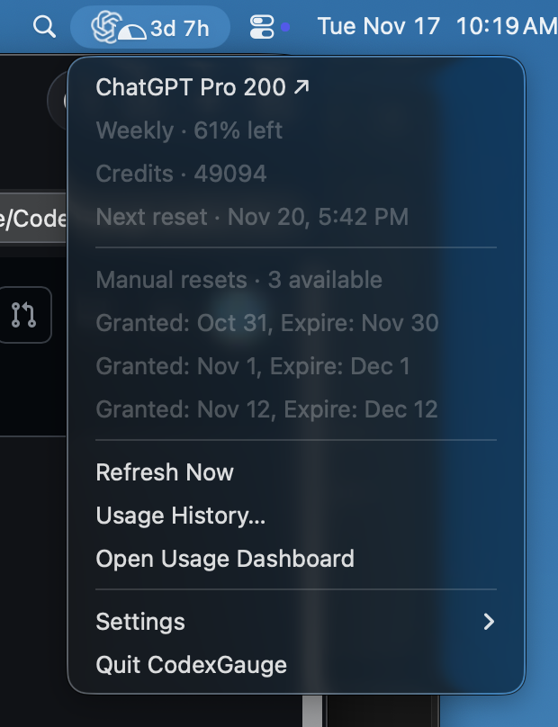

# CodexGauge

A macOS menu-bar app for keeping track of your ChatGPT plan’s Codex usage, upcoming resets, and manual reset tickets.

<p align="center">
  
</p>

## At a glance

- **Usage and credits:** see your plan, remaining allowance, and credit balance in the main menu.
- **Next reset:** the countdown uses the earlier of your normal allowance reset and a confirmed upcoming automatic extra reset.
- **Manual reset tickets:** grant and expiration dates appear directly in the main menu. Tickets are never redeemed automatically.
- **Expiry reminders:** choose reminders at 7, 3, and 1 day before a ticket expires, independently.
- **Usage history:** review the last 24 hours, 7 days, or 30 days of recorded usage.

The menu-bar gauge can rotate between percentage remaining, time until reset, and credits. Choose the fields and rotation speed under **Settings**.

## Install

Download [CodexGauge 2.5](https://github.com/halfdome/CodexGauge-public/releases/tag/v2.5) for Apple Silicon or Intel Macs running macOS 13 or later:

- **Installer:** open `CodexGauge-2.5-universal.pkg` and follow the prompts to install in Applications.
- **ZIP:** unzip `CodexGauge-2.5-universal.zip` and drag CodexGauge to Applications.

Quit any older copy before replacing it. Existing settings and local history are preserved. Open CodexGauge from Applications; it appears in the menu bar. An installed official ChatGPT/Codex helper or Codex CLI and your existing ChatGPT sign-in are required. Install the official ChatGPT app for its menu-bar logo and detailed plan labels.

The installer is unsigned and the app is ad-hoc signed; neither is notarized by Apple. macOS may require approval in **System Settings → Privacy & Security**. Download releases only from this repository.

## Using the menu

**Refresh Now** checks usage, manual reset tickets, and reset announcements together. Usage and tickets also refresh automatically every five minutes; announcement checks have their own schedule.

**Open Usage Dashboard** opens your account’s usage page, where you can review manual reset options. Clicking the plan heading opens billing. A reset-news link appears when an upcoming or retained past announcement is available.

Hover over usage, reset, or ticket information for exact timestamps and additional details. The last successful usage check appears on the plan and usage tooltips. Observed reset history appears on the next-reset tooltip when available.

**Settings** contains:

- **Manual Reset Expiry Reminder** — separate choices for 7 days, 3 days, and 1 day before expiry.
- **Reset Announcements** — automatic checks, frequency, and sources.
- **Menu Bar Display** and **Rotation Speed** — what appears beside the gauge and how often it changes.
- **Launch at Login** — start CodexGauge when you sign in to your Mac.

## Manual reset reminders

Reminders are enabled by default. Allow CodexGauge notifications in **macOS System Settings → Notifications**, then return to the app or click **Refresh Now**.

Each enabled timing schedules one notification per available ticket with a known expiration. Turning off one timing cancels only that timing’s pending notifications. Choices and duplicate-prevention records survive app restarts. If a ticket is discovered late, the app sends only the most urgent missed reminder among your enabled choices, followed by any future reminders.

Only account-reported tickets and expiration dates are used. If the service provides a count without details, or only some ticket details, the menu says so. Missing expiration dates are not guessed; explicitly nonexpiring tickets show **Expire: None** and receive no expiry reminders.

Keep CodexGauge running to notice redeemed tickets, account changes, or revised expiration dates and update pending reminders. macOS may deliver already scheduled notifications while the app is closed, subject to notification permissions, Focus, and sleep behavior. Failed account reads pause pending reminders until a successful refresh. No reset ticket is consumed by monitoring or sending a reminder.

## Automatic reset announcements

CodexGauge checks configured announcement sources hourly by default. **Settings → Reset Announcements** offers intervals from five minutes to one day.

Default sources include OpenAI News RSS, the Codex changelog RSS, and a third-party RSS mirror of Tibo’s X account (@thsottiaux). Mirror posts are checked against X’s public embed service before they can affect the countdown; no X sign-in is required.

Only announcements with explicit timing and supported eligibility are used. Vague promises, manual-ticket claim deadlines, and completed resets do not change the countdown. Sources can be unavailable or incomplete, so some announcements may be missed. Previously verified announcement data expires after 48 hours without verification. An announcement is never treated as evidence that your account owns a manual reset ticket.

## Usage history

Open **Usage History…** to choose a 24-hour, 7-day, or 30-day view. Green lines show recorded weekly usage; gray dashed lines mark missing readings. Hover to inspect a reading or the locally recorded events associated with a gap, such as sleep, wake, or a refresh failure. Unknown gaps remain labeled as unknown.

Readings and events stay on your Mac for 30 days. Collection begins when the app runs; earlier readings cannot be recovered. The graph cannot attribute usage to individual chats. Detected resets are observations of changes in reported usage, so corrections to the service’s figures may also appear as resets.

## Build and run

Requires macOS 13 or later, Python 3, and Xcode Command Line Tools. Reading account usage requires an installed official ChatGPT/Codex helper or Codex CLI and an existing ChatGPT sign-in.

```sh
python3 build.py --test
python3 build.py
```

For an Apple Silicon and Intel universal build:

```sh
python3 build.py --universal
```

The app is created at `build/CodexGauge.app`. Quit the previous copy before replacing it in your Applications folder. The bundle identifier stays `local.codex.usagebar`, preserving settings and local history. If you move the app, turn **Launch at Login** off before moving it and on again afterward to refresh its path.

Builds are ad-hoc signed and are not notarized by Apple. The menu-bar logo is read from a locally installed ChatGPT app when available; extracted vendor assets are not bundled with the project.

## Data and development

Account monitoring uses the official helper’s read-only `account/rateLimits/read` operation. It requests no model turns, credit purchases, or reset redemptions. There is no cloud scheduled task or Google Drive dependency. Settings, history, announcement caches, and reminder records stay on your Mac.

Plan names, including numbered Pro tiers, are resolved from the live account plan code and display-label definitions in the installed ChatGPT app. Those labels are read as data without executing its JavaScript. If the label or account metadata is unavailable, the app uses an honest fallback rather than inferring a tier or expiration. Protocol details are documented in the [official app-server reference](https://learn.chatgpt.com/docs/app-server).

<details>
<summary>Developer verification</summary>

`python3 build.py --test` covers display/countdown behavior, announcement parsing, history and gap events, ticket metadata, reminder combinations and persistence, and old/new plan-label bundle formats.

The built app executable also supports:

- `--check` — read live account usage and ticket metadata.
- `--check-notifications` — inspect native notification permission and pending reminder dates.
- `--verify-live-menu` — check the native menu structure, live refresh behavior, and each reminder timing against macOS’s notification store. This check temporarily changes the real reminder choices and restores them before returning.

Build products, credentials, personal runtime data, and extracted vendor resources are excluded from the repository.

</details>

## License

[MIT](LICENSE). CodexGauge is an independent project, not affiliated with or endorsed by OpenAI. OpenAI and ChatGPT names and logos belong to their respective owners.
